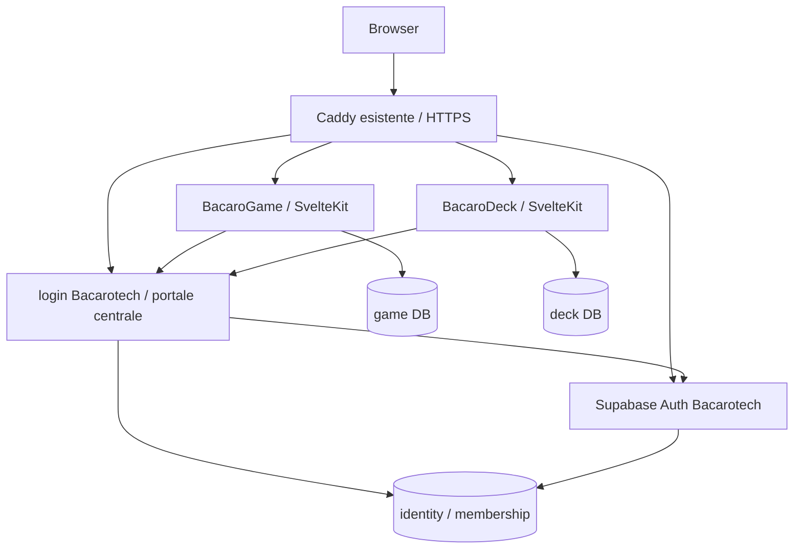

# Bacarotech: piano di migrazione a identità centrale e database su VPS

> **For agentic workers:** REQUIRED SUB-SKILL: Use superpowers:executing-plans to implement this plan task-by-task. Steps use checkbox (`- [ ]`) syntax for tracking.

**Goal:** realizzare sulla VPS personale un esempio riproducibile di piattaforma Bacarotech con identità condivisa, accessi per progetto, database isolati e deploy automatici per BacaroGame e bacarodeck-demo.

**Architecture:** stack Docker Bacarotech separato da Hidrospace. Supabase Auth dedicato per le identità, portale centrale per il login tra app, PostgreSQL con database e credenziali distinti; le app SvelteKit espongono le API e accedono al DB dal server. Caddy termina TLS; GitHub Actions costruisce immagini versionate su GHCR e le distribuisce sulla VPS.

**Tech Stack:** Docker Compose, Caddy esistente, PostgreSQL, Supabase Auth/GoTrue, SvelteKit con adapter-node, TypeScript, driver PostgreSQL e migrazioni SQL versionate; OAuth/OIDC con libreria mantenuta, GitHub Actions, GHCR.

**Spec:** intenti e decisioni proposte nelle sezioni seguenti di questo documento. È una proposta da revisionare, non un'autorizzazione a effettuare il cutover.

Data: 19 ottobre 2026. Ambito dell'analisi: file locali e fonti ufficiali; nessun accesso SSH, lettura dei dati cloud, pull Docker o cambiamento infrastrutturale eseguito. I nomi dei file futuri sono proposte; i percorsi attuali citati sono stati osservati.

## Vincoli globali

- La VPS è personale e condivisa con lo staging di un cliente: nessun riuso di database, utenti DB, segreti, volumi o network backend Hidrospace.
- Conservare deploy automatico dopo push sul branch concordato; proteggere migrazioni distruttive con una procedura distinta.
- BacaroGame usa Node 22, versione almeno 22.17 e inferiore a 23, secondo AGENTS.md; uniformare inizialmente le due app a una patch supportata della major compatibile. Rivalutare il runtime prima dell'adozione stabile.
- Foto, descrittori biometrici, cookie, token e credenziali non devono entrare nei log, nelle immagini, nei report o nelle fixture.
- Gameplay pubblico resta pubblico; il login riguarda amministrazione e funzionalità già protette.
- Firebase resta operativo fino a verifica e cutover di ciascuna app. Non toccare le collezioni di altri progetti.
- Nessuna promessa di capacità illimitata: spariscono le quote Firestore, restano CPU, RAM, disco, banda, SMTP, provider OAuth e responsabilità operative.

## Review focus

1. Due utenti modificano la stessa entità: conflitto esplicito, nessuna sovrascrittura silenziosa o perdita di rating.
2. Un amministratore viene revocato con sessione aperta: scritture immediatamente negate e accessi protetti negati entro il limite documentato.
3. Login avviato su un'app con redirect manipolato: nessun token esposto e nessun redirect verso origini arbitrarie.
4. Un consenso Bacarodex viene ritirato mentre esiste una cache o un tentativo aperto: registrazione esclusa immediatamente dalle nuove risposte.
5. Un deploy fallisce dopo una migrazione: versione applicativa precedente recuperabile se lo schema è compatibile, nessun ripristino automatico che cancelli nuove scritture.

## 1. Stato rilevato

### VPS: modello Hidrospace

Percorso analizzato: `/Users/jollymick/SProject/hidrospaceitalia/hidrospace-italia`.

- `docker/docker-compose.staging.infra.yml`: PostgreSQL 16 Alpine, MinIO, init DB, GoTrue, pgweb. Network esterna `hidrospace-net`, volumi dedicati, DB non pubblicato; pgweb su loopback.
- GoTrue usa `supabase/auth:v2.177.0`, il DB applicativo del cliente e le stesse credenziali Postgres di bootstrap. Signup disabilitato, email abilitata, autoconferma attiva; nel file non è configurato Google.
- Quel compose non è l'intera piattaforma Supabase: non include PostgREST, Studio e Realtime. GoTrue da solo non trasforma Postgres in un servizio dati Supabase.
- `docker/docker-compose.staging.yml`: immagini GHCR con `RELEASE_SHA`, servizi separati dall'infrastruttura.
- `.github/workflows/deploy-staging.yml`: push main → build/push GHCR → copia file via SSH → pull/up sulla VPS. Migrazioni attualmente separate e manuali; concurrency impedisce deploy sovrapposti del workflow.
- `docker/Caddyfile.staging.snippet` indica che Caddy canonico vive nel repo `jm90dev-infra`, `sites/hidrospace.caddy`. Quel repo e lo stato effettivo della VPS non sono stati verificati. Usare il file canonico, non modificare lo snippet come se fosse attivo.

### BacaroGame

- SvelteKit/Svelte 5, adapter-vercel, Node 22. Gran parte dei giochi non richiede backend né login.
- Auth Google nel client (`src/lib/firebase/firebase.client.ts`), creazione sessione in `src/routes/api/session/+server.ts`, verifica cookie in `src/hooks.server.ts`.
- Autorizzazioni e superadmin gestiti da `src/lib/server/superadmins.ts` e `admin-policy.ts`; root permanenti da environment, aggiunte/revoche persistite.
- `src/lib/firebase/collections.ts` consente soltanto `bacarodexMembers` e `bacaroGameConfigurations`. Le collezioni `change_requests`, `fcm_tokens`, `invites`, `slots`, `speakers`, `users` sono riservate al progetto interviste: esclusione obbligatoria dall'export Game.
- Membri, descrittori e consenso sono server-only. Marker versione aggiornato atomicamente con le modifiche per invalidare la cache; non perderne la semantica nel passaggio SQL.
- Le catture del gameplay pubblico sono in localStorage, non una collezione da trasferire al server. Esistono route legacy da inventariare separatamente.
- `README.md` e `COLLEZIONI_FIREBASE.md` descrivono consenso, esclusione dei vecchi consensi, revoca, visibilità e confini dati da preservare.

### bacarodeck-demo

- SvelteKit/Svelte 5 con adapter-vercel; autenticazione Google Firebase, bearer token dal client e controllo server in `src/lib/server/authorize.ts`.
- `src/lib/repository.ts` usa già API applicative: `watchCollection` effettua polling ogni 60 secondi quando la pagina è visibile, non un listener realtime Firestore.
- Dati sotto `workspaces/codemotion-milano-2026`: speakers, talks, sources, materials, insights, questions, interviewPlans, interviewSlots; anche members, access/members e archivio domande eliminate da inventariare.
- `src/lib/server/firestore-cache.ts` dipende da `getCache` di `@vercel/functions`: va sostituito per funzionare sul VPS.
- API di salvataggio, rating e accesso usano transazioni Firestore, revisioni e policy: la migrazione deve mantenere questi comportamenti.
- Non risultano directory `.github` nei due progetti analizzati. Il deploy Vercel è documentato/configurato localmente, ma l'integrazione Git effettiva va verificata negli account.

La root `Bacarotech` non è un repository Git unico: i due progetti sono repository separati. Questo piano è salvato nel repository BacaroGame per essere versionabile; l'infrastruttura comune avrà un proprio repository. Non sono state lette le chiavi JSON o i valori dei file `.env`.

## 2. Scelta architetturale

| Opzione | Vantaggi | Costi e limiti | Valutazione |
|---|---|---|---|
| Supabase completo self-hosted | API dati, dashboard, storage/realtime disponibili | Più servizi, RAM, upgrade coordinati; condivisione del DB richiede policy rigorose | Valido se la community vuole usare davvero queste API |
| Auth dedicato + PostgreSQL + API SvelteKit | Riusa i backend attuali, isolamento DB, stack più piccolo | Repository SQL, migrazioni e portale login da mantenere | **Proposta per il campione iniziale** |
| Provider OIDC dedicato + PostgreSQL | SSO e lifecycle client come responsabilità del provider | Nuovo componente da imparare, abbandona parte del riuso Supabase | Alternativa se il gate OAuth/OIDC fallisce |

Scelte proposte dall'analisi, non già approvate dall'utente: Google come primo metodo di accesso; un realm Bacarotech dedicato; database per progetto; PostgreSQL condiviso soltanto come processo Bacarotech; niente Redis, MinIO o Supabase completo inizialmente; prima Deck, poi Game.

I tre database possono stare in un solo nuovo container PostgreSQL dedicato a Bacarotech: `bacaro_identity`, `bacaro_game`, `bacaro_deck`. Autorizzazioni SQL e ownership distinte; nessuna foreign key tra database. Le app usano UUID centrali come identificatori opachi. Eventuali dati mancanti per utenti non ancora migrati restano associati al legacy ID tramite mapping verificato.

Network: `bacaro-edge` collega Caddy ai soli servizi HTTP; network backend distinti per identity, game e deck collegano ciascuna app al Postgres Bacarotech. Il processo DB comune resta un dominio di guasto condiviso: è isolamento logico, non isolamento hardware. Il DB non partecipa alla rete edge. Nessun alias generico che interferisca con `postgres` Hidrospace.

## 3. Login centrale: significato e gate di fattibilità

Usare la stessa istanza Auth nelle due app dà account condivisi, ma le sessioni browser non diventano automaticamente comuni tra origini. Obiettivo proposto: login sul portale, quindi accesso alla seconda app tramite redirect senza ripetere Google finché la sessione centrale è valida; cookie applicativi limitati al proprio host. Evitare un cookie condiviso sull'intero dominio personale, dove vivono anche servizi del cliente.

### Gate obbligatorio prima di integrare le app

- [ ] Verificare nella release self-hosted scelta di Supabase Auth il supporto effettivo OAuth 2.1/OIDC: discovery, registrazione client, authorization code + PKCE, token endpoint, chiavi pubbliche, claims e refresh/revoca. La documentazione del prodotto non prova da sola che tutte le funzioni siano abilitate nella configurazione Docker scelta.
- [ ] Provare due client locali, redirect esatti, scambio codice server-side, persistenza sessione sul portale e seconda app senza nuovo login Google. Provare anche logout e sessione scaduta.
- [ ] Se il gate passa, usare quel provider con una libreria OIDC mantenuta e una pagina login/consenso centrale; nessun protocollo OAuth costruito a mano.
- [ ] Se non passa, registrare una decisione: accettare temporaneamente solo identità condivisa con due sessioni indipendenti oppure introdurre un provider OIDC dedicato. Non promettere SSO completo con la sola sostituzione dell'SDK.

Domini proposti, da confermare tramite DNS e proprietà: `login-bacaro.jm90dev.cloud`, `auth-bacaro.jm90dev.cloud`, `game-bacaro.jm90dev.cloud`, `deck-bacaro.jm90dev.cloud`. Sono host piatti coerenti con lo schema documentato per il certificato Cloudflare; il dominio finale della community potrà sostituirli tramite configurazione. La callback Google è quella dell'endpoint Auth, distinta dalle callback OAuth/OIDC delle app. Con GoTrue diretto, verificare `/callback`; con gateway `/auth/v1`, verificare `/auth/v1/callback`. Non mescolare le due configurazioni.

Sessioni applicative: cookie Secure, HttpOnly, SameSite=Lax, host-only, identificatore casuale e stato server-side; TTL e rinnovo espliciti. Verificare state, nonce quando previsto da OIDC, PKCE, issuer, audience, algoritmo, firma e scadenza. Codici monouso e redirect allowlist esatta; nessun access/refresh token nelle URL applicative. Endpoints mutanti protetti da controllo Origin/CSRF. Non basta decodificare un JWT o fidarsi dei dati inviati dal browser.

Identità != permessi: login Google valido non implica appartenenza alla community o accesso a un progetto. In `bacaro_identity`, schema separato da `auth`, prevedere:

- `community_members(user_id, status, created_at, updated_at)`;
- `project_memberships(user_id, project_key, role, status, version, updated_at)` con PK composta;
- `legacy_identities(source_project, firebase_uid, user_id, verified_at)` con unicità su progetto sorgente + UID;
- audit accessi amministrativi senza token o dati biometrici.

Ruoli iniziali: member/editor dove richiesto, admin, project_superadmin; gestore della piattaforma distinto dal superadmin del singolo progetto. Root iniziali configurati esplicitamente, mai “primo utente diventa admin”. Preservare blocchi e protezione dell'ultimo superadmin; una revoca esplicita prevale sulle liste di bootstrap salvo i root permanenti già previsti.

Esporre dal portale un endpoint interno autenticato di autorizzazione `POST /internal/access/check` con `{userId, projectKey}` → `{allowed, role, version}`. Le app non ricevono credenziali del DB identity. Prima versione: controllo fresco su ogni richiesta protetta, fallimento chiuso con 503 se il servizio è indisponibile; nessuna cache permissiva. Scritture amministrative sul portale transazionali. Logout locale e “esci da tutte le app” distinti: il secondo invalida le sessioni server tramite registro centrale/versione sessione e revoca refresh. Testare questo comportamento, senza affidarlo alla sola scadenza del JWT.

## 4. Database e porting dei dati

Ogni DB ha un owner/migrator e un runtime role senza DDL, SUPERUSER o BYPASSRLS. GoTrue usa un ruolo dedicato con i privilegi richiesti dalle sue migrazioni nello schema auth, non il superuser comune delle app. Bootstrap amministrativo separato dal runtime. Impostare limiti di connessione e timeout: budget iniziale proposto di 5 connessioni per istanza applicativa, da confermare includendo Auth, migrazioni e monitoraggio. Niente pooler aggiuntivo finché le misure non lo richiedono.

Le API server sono il confine di autorizzazione: il browser non riceve DATABASE_URL né accesso SQL. RLS non è automaticamente efficace con un driver server: se introdotta servono ruoli non privilegiati e contesto per transazione, con test. Non confondere un servizio PostgreSQL interno con un endpoint dati pubblico.

### Game

Tabelle proposte: `members` con legacy document ID, owner UUID nullable, legacy owner UID, tipo registrazione, operatore, Pokémon, modello, descrittore privato, consenso e timestamp; `configurations` con chiave, payload JSONB e revisione; `state_versions` per marker membri. Campi definitivi ricavati dall'inventario di tutte le route, incluse quelle legacy.

Gli ID di registrazione restano stabili: oggi policy e document ID possono coincidere con Firebase UID. Sostituire la verifica `memberId === userId` con ownership esplicita verificata, senza riscrivere indiscriminatamente gli ID. Le persone registrate da operatori possono non avere account e non devono riceverne uno automaticamente.

Ogni scrittura membro e incremento marker avviene nella stessa transazione SQL. Ogni riuso cache verifica il marker; revoca ed eliminazione invalidano i tentativi come oggi. Importare il consenso esistente senza elevarne versione o visibilità; escludere dal gioco pubblico i consensi incompatibili. Non aggiungere sincronizzazione delle catture locali.

### Deck

Prima migrazione conservativa: `entities(workspace_id, collection, id, revision, payload JSONB, created_at, updated_at)` con PK composta e allowlist delle otto collezioni; tabelle dedicate per rating, accessi e archivio cancellati se necessarie a preservare le operazioni attuali. Conservare i contratti JSON delle API: la normalizzazione completa del dominio può seguire dopo il cutover.

Update con confronto della revision e incremento atomico; zero righe aggiornate = conflitto 409. Una richiesta di salvataggio con più modifiche resta atomica. Rating con unicità `(workspace_id, question_id, user_id)` e upsert transazionale, senza perdita dei voti durante il salvataggio editoriale. Documentare il merge di voti di identità duplicate prima dell'import. Preservare soft-delete/restore e riferimenti tra entità.

Migrare `createdBy`, `updatedBy`, `assignedToUid`, members e chiavi UID nei rating usando mapping esplicito; conservare valore legacy quando manca una corrispondenza. Non eliminare audit o assegnazioni degli utenti che non hanno ancora effettuato login.

Sostituire la cache Vercel con cache in memoria limitata solo per dati non autorizzativi, prima versione con un'istanza per app. Le invalidazioni avvengono dopo commit. Per più istanze: marker DB o servizio condiviso prima dello scale-out. Polling a 60 secondi inizialmente invariato; indici, ETag e letture incrementali valutati su misure reali.

## 5. Migrazione identità e dati: procedura

1. Inventariare progetti Firebase effettivi, provider, quantità documenti, dimensioni, indici, sottocollezioni e utenti realmente associati alle due app. Non esportare l'intero progetto Firebase condiviso alla cieca.
2. Export cifrato e manifest con conteggi, tipi e checksum; output esterno ai repository. Documentare normalizzazione Timestamp, reference, null, array e date. Leggere le sole collezioni consentite e le sottocollezioni censite.
3. Account Google: creare/linkare identità mediante flussi supportati. Associazione iniziale soltanto con identità verificata e controllo amministrativo di conflitti; non basta una email dichiarata. L'eventuale matching su email verificata deve avere regola scritta e test su email duplicate, cambiate e provider differenti.
4. Conservare Firebase UID come legacy, usare UUID centrale nuovo. Non copiare hash password come password Supabase: se esistono utenti password reali, usare reset o una procedura supportata verificata separatamente. Nessun account di emulatori da migrare.
5. Import idempotente per chiave sorgente, transazioni a batch limitato e report degli errori; secondo passaggio non duplica record o concessioni. Importare prima identità/mapping e autorizzazioni, poi dati applicativi. Consentire utenti non ancora linkati senza perdere dati.
6. Rehearsal con dati sintetici, poi prova cifrata e controllata su copia reale se necessaria. Confrontare conteggi per collezione, revisioni, rating, ownership, consensi, eliminati e riferimenti; differenze spiegate nel report.
7. Cutover per singola app: maintenance mode delle scritture Firebase, export finale consistente dopo stop scritture, import finale, verifica, cambio configurazione/traffico, smoke test. Finestra obiettivo 30–60 minuti da validare durante la prova.
8. Niente dual-write iniziale: aumenta il rischio di divergenze e la complessità della demo.
9. Tenere backup e deployment precedente per una finestra proposta di 14 giorni. Firebase non è più scrivibile dalla vecchia app; le regole condivise devono continuare a servire le altre applicazioni.

Rollback prima di nuove scritture SQL: tornare al deployment/configurazione Firebase precedente. Dopo nuove scritture SQL: mettere in manutenzione, esportare e riconciliare il delta con uno script provato oppure correggere in avanti. Un semplice cambio DNS dopo nuove scritture perde dati e non è un rollback accettabile. Non cancellare Firebase fino ad accettazione e verifica del ripristino.

## 6. CI/CD e hosting

Repository proposto `bacarotech-infra` per compose, provisioning, backup e runbook; riuso del Caddy canonico in `jm90dev-infra` tramite sito Bacarotech separato. Ogni app conserva il proprio repository, immagine e pipeline.

Pipeline applicativa:

1. PR: `npm ci`, check e test pertinenti, build con Node compatibile; niente segreti VPS su PR, specialmente da fork.
2. Push main: stessi controlli, build multi-stage con adapter-node, processo non-root, push immagine GHCR con commit SHA e digest. Configurazione pubblica di build separata dai segreti runtime; `.dockerignore` esclude `.env*`, chiavi JSON, export, log, `.git` e output locali.
3. Job deploy dipendente dai controlli, environment GitHub dedicato. GHCR privato quando appropriato; GITHUB_TOKEN in CI e token read-only sul VPS per pull. Azioni pin per commit verificato, permessi minimi.
4. SSH con utente deploy dedicato e host key verificata; niente accesso del workflow pubblico ai servizi cliente. Limitare il comando deploy a directory e immagini Bacarotech. Appartenere al gruppo Docker equivale a poteri elevati: preferire wrapper amministrativo limitato, senza spacciare il gruppo Docker per isolamento.
5. Lock sul VPS oltre alla concurrency GitHub, perché i workflow di repository distinti possono sovrapporsi. Lock separati app e lock condiviso per operazioni identity/infra.
6. Validare manifest, pull per digest, verificare backup quando cambia lo schema, eseguire migration job con ruolo migrator e lock; deploy app soltanto se migrazioni compatibili passano. Migrazioni automatiche additive; contract/drop e upgrade Auth/DB con procedura separata e backup verificato.
7. `up -d --wait` con timeout, readiness DB/app e test HTTPS esterno. Exit nonzero su pull, migration, health o smoke falliti; conservare versione precedente e diagnostica senza segreti.
8. Rollback automatico dell'immagine soltanto con schema compatibile. Registrare commit, digest, schema version e risultato. Notifica del fallimento tramite canale da configurare.

Il deploy può avere un breve riavvio inizialmente: nessuna promessa zero downtime con un singolo container. Blue/green si aggiunge se serve. Le preview Vercel possono restare come comodità temporanea, con backend di test isolato; non usare production DB nelle preview pubbliche. Disabilitare il doppio deploy production dopo il cutover, non prima.

Docker: impostare `ORIGIN` corretto per adapter-node, porta 3000 interna, trusted proxy/header configurati solo rispetto a Caddy, body limit coerente con upload e scansioni, graceful shutdown, log rotation, memory/CPU limits. Conservare build dei modelli Human e checksum nel Game; verificare consumo RAM del build in CI e del matching sul server.

## 7. Operazioni e capacità

Prima dell'installazione misurare via accesso autorizzato: RAM/vCPU/disco reali, spazio Docker, RAM disponibile sotto carico Hidrospace, I/O, reti, versioni Docker/Compose e backup esistenti. Nessun dimensionamento affidabile ricavabile dal solo codice. Non occupare la memoria residua senza riserva cliente/OS. Se non c'è margine, spostare Bacarotech su VPS distinta anche per la demo.

Backup proposto: dump cifrato giornaliero dei tre DB, configurazione e segreti con canale separato; copia fuori VPS, retention iniziale 7 giornalieri + 4 settimanali. Obiettivi da accettare: RPO 24 ore e RTO 4 ore. Prima del cutover fare restore completo su DB puliti e login applicativo; ripetere mensilmente. Per esigenze più strette aggiungere WAL/PITR. I backup includono anche dati cancellati fino a scadenza retention: runbook per non reintrodurre consensi revocati al restore.

Monitorare HTTPS, disponibilità Auth/DB, errori 5xx, tempi query, pool, CPU/RAM, spazio disco, età backup e fallimenti deploy. Metriche iniziali proposte: p95 API protette <500 ms a carico rappresentativo escluso face matching; errori <1%; nessun OOM; almeno 20% disco libero. Misurare separatamente scansioni facciali e carico concorrente del cliente. Questi sono criteri da validare, non prestazioni osservate.

Applicare rate limit agli endpoint login e scansioni pubbliche, limite concorrenza per matching, timeout e limiti payload; CDN/cache per modelli e asset statici. Nessuna scansione completa DB a ogni polling se il dataset cresce. SMTP va configurato per inviti/reset se attivati; Google OAuth può avere vincoli di pubblicazione e utenti test da verificare nella console.

Per la migrazione dei dati biometrici preservare consenso, versioni, cancellazione e visibilità esistenti; verificare separatamente l'idoneità della nuova destinazione prima di copiare dati reali. La fattibilità tecnica non dimostra che il consenso attuale copra il nuovo trattamento. Per presentare l'esempio alla community usare dati sintetici o volontari con percorso confermato.

## 8. Piano esecutivo per fasi

### Fase 0 — Inventario e decisioni, 0,5–1 giornata

**File da creare:** `bacarotech-infra/docs/decisions/0001-platform.md`, `docs/inventory.md`, `docs/data-map.md`, `docs/capacity.md`.

- [ ] Confermare dominio, account GitHub/GHCR, branch deploy e carico atteso (utenti attivi e picchi evento).
- [ ] Rilevare stato reale VPS senza stampare environment o credenziali. Individuare repo Caddy canonico.
- [ ] Completare inventario Firebase e schema dei dati, incluse route legacy, cache, script seed/export e policy.
- [ ] Definire il perimetro community rispetto a utenti esterni dei progetti; permessi distinti per Game e Deck.
- [ ] Verificare i manifest immagini per architettura VPS. Il compose ufficiale consultato usa `supabase/gotrue:v2.197.0`; `supabase/auth:v2.177.0` non è stato provato e non va assunto alias valido. Eseguire `docker manifest inspect` e pull della versione scelta nell'ambiente di prova; registrare digest e provenienza. Non cambiare Hidrospace.
- [ ] Riesaminare diff e registrare le decisioni nel repository infra.

**Uscita:** inventario completo, margine risorse sufficiente, nessuna modifica cliente necessaria. Se manca margine, cambiare host prima delle fasi successive.

### Fase 1 — Prova Auth/SSO isolata, 1–3 giornate

**File proposti:** `bacarotech-infra/experiments/auth-sso/compose.yaml`, `README.md`, fixture di due client e test di integrazione.

**Interfaccia:** identità UUID, due client indipendenti, issuer e callback espliciti; risultato del gate della sezione 3.

- [ ] Scrivere scenari attesi: login, seconda app, callback alterata, revoca, logout globale e indisponibilità provider.
- [ ] Avviare Auth su DB di test, configurare Google di test e provare schema bootstrap/ruolo dedicato.
- [ ] Eseguire il gate OAuth/OIDC e registrare esattamente cosa funziona nella release self-hosted scelta.
- [ ] Provare i casi negativi con una libreria standard; verificare che nessun token entri in log/URL.
- [ ] Registrare scelta finale SSO, versioni/digest e limiti; non trasferire ancora utenti reali.

**Uscita:** SSO dimostrato oppure decisione esplicita di riduzione scope/provider alternativo. Stima successiva da aggiornare se cambia il provider.

### Fase 2 — Infrastruttura e ripristino, 1–2 giornate

**File proposti in infra:** `compose.infra.yaml`, `compose.apps.yaml`, `.env.example` senza valori reali, `postgres/bootstrap.sql`, `scripts/backup.sh`, `scripts/restore.sh`, `scripts/deploy.sh`, `docs/runbook.md`. Nel repo edge: `sites/bacarotech.caddy`.

- [ ] Creare network/volumi/DB/ruoli Bacarotech, limiti e healthcheck, con provisioning ripetibile e segreti runtime esterni a Git.
- [ ] Validare `docker compose config --quiet` con fixture e verificare grant DB negativi: game non legge deck/identity, runtime non crea tabelle, nessun DB pubblicato.
- [ ] Configurare host Caddy, controllare sintassi prima del reload e verificare routing Bacarotech e continuità Hidrospace.
- [ ] Implementare backup e restore; provare su volumi nuovi anche identità e chiavi necessarie alle sessioni.
- [ ] Verificare crash/restart, log rotation e soglie risorse; registrare il ripristino riuscito e committare configurazione priva di segreti.

**Uscita:** infrastruttura isolata, backup offsite e restore provato.

### Fase 3 — Portale identità e accessi, 2–4 giornate

**Repository/file proposti:** `bacaro-account/src/lib/server/{auth,access,sessions}.ts`, route login/callback/logout e `/internal/access/check`, migrazioni identity, test di integrazione access/sessioni. Il layout finale segue la soluzione provata in fase 1.

- [ ] Scrivere test di autorizzazione: membro di un progetto non accede all'altro, root iniziale esplicito, ultimo superadmin, account disattivato.
- [ ] Implementare membership e API interna autenticata della sezione 3; testare richieste falsificate e indisponibilità.
- [ ] Implementare sessioni e flusso OIDC con libreria, validazione token e logout; testare revoca con sessioni già aperte su due app.
- [ ] Creare gestione minima degli accessi senza assegnazioni implicite; audit delle modifiche e bootstrap ripetibile.
- [ ] Preparare pipeline portale, build ed E2E; review e commit.

**Uscita:** un utente può appartenere alla community con permessi diversi nelle due app; revoca e logout rispettano i test.

### Fase 4 — BacaroDeck pilota, 2–4 giornate

**Modificare:** `bacarodeck-demo/package.json`, `svelte.config.js`, `src/routes/+page.svelte`, `src/lib/repository.ts`, componenti che richiedono token Firebase, `src/lib/server/authorize.ts`, `member-access.ts`, `firestore-cache.ts`, tutte le route `src/routes/api` che usano Admin SDK.

**Creare:** `src/lib/server/db.ts`, `src/lib/server/entities-repository.ts`, `src/lib/server/session.ts`, `src/hooks.server.ts`, `migrations/`, `docker/Dockerfile`, `.dockerignore`, `.github/workflows/deploy.yml`, test SQL/auth e script export/import.

**Interfaccia:** API applicative esterne conservate; auth passa a sessione server, `authorize` restituisce identità centrale e permessi, nessuna dipendenza Firestore nel contratto client finale.

- [ ] Prima dei cambi scrivere test significativi per batch atomico, revisioni 409, rating concorrente, cancellazione/ripristino e accessi negati; eseguirli e verificare fallimento sul repository SQL assente.
- [ ] Implementare schema e repository SQL con query parametrizzate e collection allowlist; rieseguire test su PostgreSQL temporaneo.
- [ ] Integrare login centrale e cookie; rimuovere richieste getIdToken e dipendenze Firebase dal browser dopo parità verificata.
- [ ] Sostituire cache Vercel, conservare polling e stato offline; verificare invalidazione dopo salvataggio e logout.
- [ ] Passare ad adapter-node, container e workflow; eseguire `npm run check`, `npm test`, E2E e build. Aggiornare i test Firebase Rules con test del nuovo confine API, non eliminarne semplicemente le aspettative di sicurezza.
- [ ] Provare import due volte, conteggi e mapping su copia; deploy a host pilota, E2E HTTPS, review diff e commit.

**Uscita:** Deck utilizzabile da due membri contemporaneamente senza Firebase né runtime Vercel.

### Fase 5 — BacaroGame, 2–4 giornate

**Modificare:** `BacaroGame/package.json`, `svelte.config.js`, `src/hooks.server.ts`, `src/routes/api/session/+server.ts`, `src/lib/firebase/firebase.client.ts`, `src/lib/Login.svelte`, `src/lib/server/{members,member-cache,game,superadmins,admin-policy}.ts`, route `/api/bacarodex/*` e `/api/merge-battle/config`.

**Creare:** `src/lib/server/db.ts`, `members-repository.ts`, `configurations-repository.ts`, `session.ts`, migrazioni, Dockerfile, `.dockerignore`, workflow e test SQL/import. Inventariare altri import Firebase con ricerca completa prima di rimuovere il gateway.

- [ ] Scrivere test di proprietà membro separata da ID legacy, registrazione di terzi, esclusione consenso vecchio, revoca immediata con cache calda e tentativo già emesso.
- [ ] Implementare repository e transazioni SQL, marker versione atomico, policy e mapping UUID; eseguire test con concorrenza reale su PostgreSQL.
- [ ] Integrare portale preservando home e giochi pubblici, area admin e protezione dell'ultimo superadmin.
- [ ] Configurare adapter-node e build modelli Human; verificare che descrittori non compaiano in bundle, risposte pubbliche o log.
- [ ] Eseguire `npm run check`, `npm run test:superadmins`, test di gioco pertinenti e nuovi test SQL/import, poi `npm run build`. Sostituire `check:collections` con controllo del nuovo confine solo dopo aver eliminato gli accessi Firestore; mantenerlo durante la transizione.
- [ ] E2E da telefono HTTPS: camera, QR/hash routing, registrazione, scansione, ritiro, giochi offline dal backend; prova carico scansioni, review diff e commit.

**Uscita:** nessuna regressione di gameplay, policy o consenso; dati di altre app Firebase intatti.

### Fase 6 — Prove operative e cutover, 1–2 giornate più osservazione

**File:** runbook cutover per app, manifest import, report verifiche e registro release in infra; nessun dato personale nei report versionati.

- [ ] Provare deploy fallito, lock tra repository, DB indisponibile e rollback con schema compatibile.
- [ ] Completare prova restore e misure carico misto; confermare RPO/RTO e finestra scritture ferme.
- [ ] Migrare Deck con procedura della sezione 5; osservare almeno 48 ore e raccogliere feedback prima del Game.
- [ ] Migrare Game; verificare accessi e consensi senza usare i dati del cliente come fixture.
- [ ] Disabilitare vecchi deploy production automatici e vecchie scritture delle due app, mantenendo gli altri utenti Firebase operativi.
- [ ] Dopo finestra concordata, rimuovere credenziali obsolete dalle app e valutare dismissione mirata dei soli dati/servizi diventati inutilizzati.
- [ ] Dimostrazione community: aggiungere una terza app fittizia usando template e credenziali proprie, con login e DB isolato; documentare tempi e punti manuali.

**Uscita:** deploy da commit verificato su entrambe le app, login centrale dimostrabile, ripristino provato e runbook riproducibile.

## 9. Tempi e decisioni da chiudere

Stima iniziale: circa 10–20 giornate tecniche, più osservazione, con ampia variabilità su SSO e qualità dei dati. Il primo risultato utile è il gate Auth/SSO seguito dal pilota Deck; non occorre migrare tutto per apprendere dall'esperimento. Account condivisi senza SSO riducono il lavoro; un provider alternativo o dati complessi possono aumentarlo. Nessun canone cloud per richiesta DB, ma restano costo VPS/offsite/SMTP, manutenzione e possibili vincoli dei servizi esterni.

Prima dell'implementazione servono scelte concrete: host e dominio iniziali; SSO completo oppure account comune come primo traguardo; utenti ammessi e ruoli; conservazione degli account/dati Firebase o reset dei soli dati demo; capacità VPS e backup offsite disponibili; finestra di manutenzione. Le assunzioni usate nel piano sono conservare i dati reali, SSO come obiettivo, Google iniziale e priorità di continuità allo staging cliente.

## 10. Fonti ufficiali consultate

- [Compose ufficiale Supabase](https://github.com/supabase/supabase/blob/master/docker/docker-compose.yml): alla consultazione Auth usa `supabase/gotrue:v2.197.0`; questo non equivale a un pull riuscito né fissa la versione futura da adottare.
- [Self-hosting Supabase con Docker](https://supabase.com/docs/guides/self-hosting/docker): riferimento per bootstrap e gestione dei servizi; lo stack minimo qui proposto è una scelta diversa dalla distribuzione completa.
- [Provider OAuth self-hosted](https://supabase.com/docs/guides/self-hosting/self-hosted-oauth): configurazione Google e callback.
- [OAuth 2.1 server](https://supabase.com/docs/guides/auth/oauth-server): base del gate di fattibilità; verificare disponibilità e configurazione della release effettiva prima di promettere SSO.
- [Migrazione Firebase Auth](https://supabase.com/docs/guides/platform/migrating-to-supabase/firebase-auth): base per inventario e strategia identità; da adattare al self-hosted e ai provider presenti.
- [Auth server-side](https://supabase.com/docs/guides/auth/server-side/creating-a-client?queryGroups=framework&framework=sveltekit): riferimento per integrazione SvelteKit; non risolve da solo SSO tra origini.
- [Aggiornamenti self-hosted](https://supabase.com/docs/guides/self-hosting/updating): verificare upgrade su copia e registrare versioni, evitando aggiornamenti infrastrutturali impliciti a ogni deploy applicativo.
